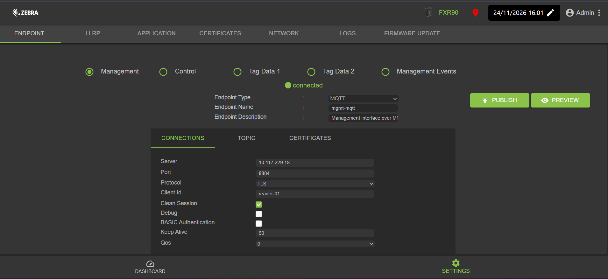
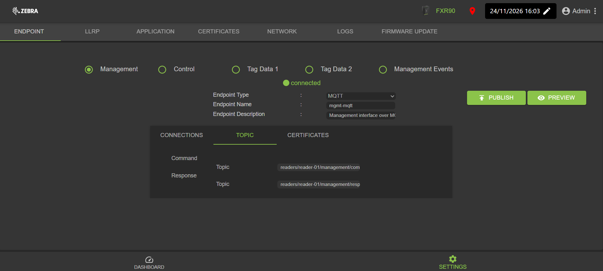
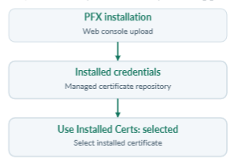
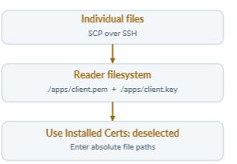
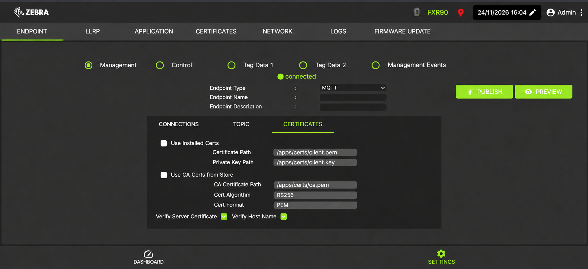
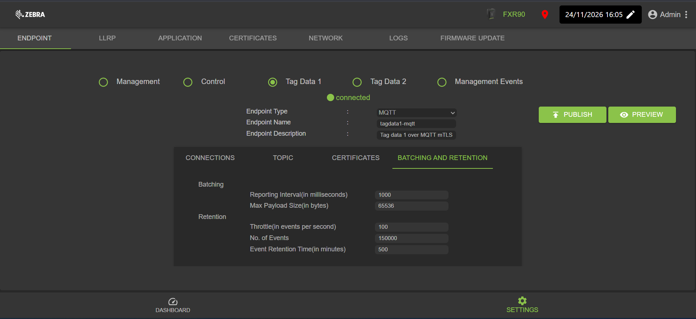
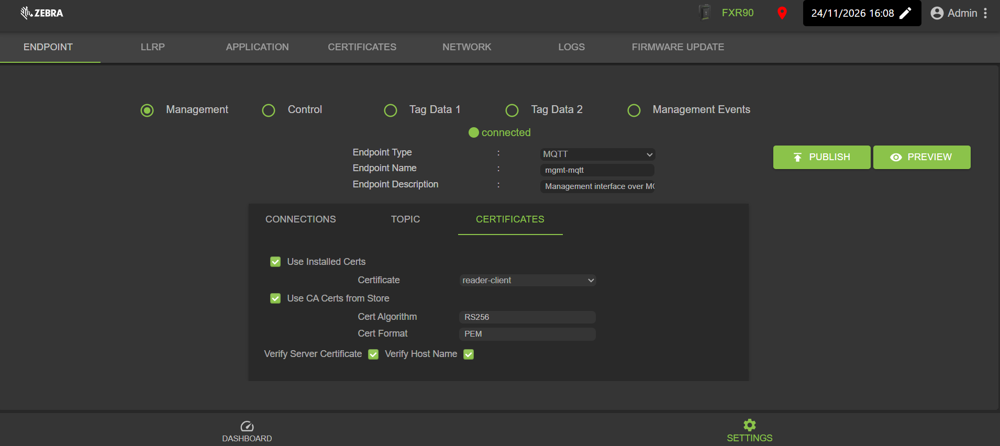
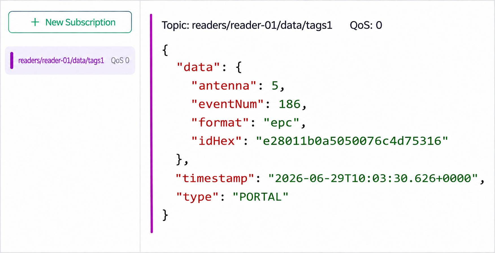

import MqttDiagram from './images/mqtt-communication.png';

This guide describes how to configure the reader to communicate with an MQTT broker using the reader web console. You can configure individual interfaces to exchange management commands, control commands, RFID tag observations, and management events with external applications.

After completing the configuration, you can verify MQTT connectivity and message exchange using an MQTT client.

<a href={MqttDiagram} aria-label="Open the MQTT communication illustration at full size">
  
</a>

<p className="figure-caption"><strong>Figure 1:</strong> Example MQTT communication between the reader, broker, and application. <a href={MqttDiagram}>View full size</a>.</p>

:::note
Configure each interface separately, even if the interfaces use the same MQTT broker. Complete Steps 1–6 for each interface, then perform the applicable communication verification in Step 7.
:::

## Before You Begin

Ensure that you can access the reader web console and that the reader can reach the MQTT broker over the network.

For each interface, obtain the following information:

- Broker hostname or IP address, listening port, and protocol.
- Unique MQTT client ID and authentication credentials, if required.
- MQTT topic names and the required publish and subscribe permissions.
- Certificates and private key, if required for a secure connection.
- Batching and retention values, if configuring Tag Data or Management Events.

To verify MQTT communication, ensure that a compatible MQTT client is available.

Select a screenshot to enlarge it.

<span id="step-1-select-the-interface" />

## Step 1: Select an Interface and Endpoint Type

In this step, you select the reader interface that will communicate with the MQTT broker and define its endpoint. The selected interface determines the type of commands, responses, or data exchanged between the reader and external applications.

1. In the reader web console, navigate to the **ENDPOINT** tab from the top navigation bar.

   

   <p className="figure-caption"><strong>Figure 2:</strong> Illustration of the Endpoint page before selecting MQTT.</p>

2. Select the interface you want to configure:

   | Interface | Purpose |
   |---|---|
   | **[Management](../introduction/ziotc-interfaces.mdx#management-interface)** | Configure and manage reader settings and retrieve reader information. |
   | **[Control](../introduction/ziotc-interfaces.mdx#control-interface)** | Configure operating modes and start or stop RFID operations. |
   | **[Tag Data 1 / Tag Data 2](../introduction/ziotc-interfaces.mdx#data-interface)** | Publish RFID tag observations to external applications. |
   | **[Management Events](../introduction/ziotc-interfaces.mdx#management-events-interface)** | Publish asynchronous reader events, such as alarms and heartbeats. |

3. From the **Endpoint Type** dropdown, select **MQTT**.
4. In **Endpoint Name**, enter a descriptive name to identify the endpoint (for example, `FXR90_Primary_Broker`).
5. In **Endpoint Description**, enter a brief description of the endpoint's purpose (for example, `Publish RFID tag data to the warehouse MQTT broker`).

:::note
Each interface is configured independently. If multiple interfaces need to communicate with the same MQTT broker, repeat the configuration for each interface.
:::

For more information, see [Interfaces and Endpoints](../introduction/ziotc-interfaces.mdx).

<span id="step-2-configure-the-connection" />

## Step 2: Configure Broker Connection Parameters

In this step, you configure the connection and authentication settings that the reader uses to establish an MQTT connection with the broker.

Select the **CONNECTIONS** sub-tab and configure the following parameters according to your MQTT broker settings.



<p className="figure-caption"><strong>Figure 3:</strong> MQTT connection settings for the selected interface.</p>

| Parameter | Description | Recommended Value / Example |
|---|---|---|
| **Server** | Hostname or IP address of the MQTT broker. | `broker.example.com` |
| **Port** | Network port on which the MQTT broker accepts connections. | See Transport Selection below. |
| **Protocol** | Transport protocol used to connect to the MQTT broker. | See Transport Selection below. |
| **Client Id** | Unique identifier used by the broker to identify the MQTT client. Use a different Client ID for each active connection to the same broker, including connections from different reader interfaces. | `FXR90_Dock1_123456` |
| **Clean Session** | When checked, the broker starts a new session and discards any previous session state associated with the Client ID. | Checked, if persistent sessions are not required. |
| **Debug** | Enables additional MQTT debug logging for troubleshooting connection and communication issues. | Unchecked |
| **BASIC Authentication** | Check this option and enter the **Username** and **Password** if the broker requires credentials. | As required by the broker |
| **Keep Alive** | Maximum interval between MQTT control packets sent by the client. Helps detect inactive connections. | `60` seconds |
| **Qos** | Specifies the MQTT message delivery guarantee: 0 (At most once), 1 (At least once), or 2 (Exactly once). | Based on application requirements |

### Transport Selection

Select the protocol and port that match your MQTT broker configuration.

| Protocol | Description | Common Port |
|---|---|---|
| **TCP** | MQTT over an unencrypted TCP connection. | `1883` |
| **TLS** | MQTT over a TLS-encrypted TCP connection. | `8883` |
| **Web Socket** | MQTT over an unencrypted WebSocket connection. | `9001` |
| **Secure WebSocket** | MQTT over a TLS-encrypted WebSocket connection. | `443` |

If you select **TLS** or **Secure WebSocket**, configure the applicable certificate settings as described in [Step 4: Configure Certificates](#step-4-configure-certificates).

:::note
The recommended values and port numbers are illustrative examples, not reader defaults. Use the settings configured on your MQTT broker.
:::

## Step 3: Configure Topics

In this step, you define the MQTT topics through which the reader exchanges commands, responses, tag observations, and management events with external applications. The available topic fields depend on the interface selected in Step 1.

1. Select the **Topic** sub-tab.
2. Configure the topic fields for the selected interface as described below.



<p className="figure-caption"><strong>Figure 4:</strong> Management command and response topic settings.</p>

### Management Interface

| Parameter | Description | Example |
|---|---|---|
| **Command Topic** | The topic the reader subscribes to for incoming management commands, such as configuring reader settings and retrieving reader information. | `readers/reader-01/management/command` |
| **Response Topic** | The topic to which the reader publishes the execution results of management commands. | `readers/reader-01/management/response` |

### Control Interface

| Parameter | Description | Example |
|---|---|---|
| **Command Topic** | The topic the reader subscribes to for incoming runtime control commands, such as configuring operating modes and starting or stopping RFID operations. | `readers/reader-01/control/command` |
| **Response Topic** | The topic to which the reader publishes the execution results of control commands. | `readers/reader-01/control/response` |

### Tag Data Interface

Configure the publish topic for the selected **Tag Data 1** or **Tag Data 2** interface.

| Parameter | Description | Example |
|---|---|---|
| **Publish Topic** | The topic to which the reader publishes RFID tag observation data in JSON format for consumption by external applications. | Tag Data 1: `readers/reader-01/data/tags1` |

If both Tag Data interfaces are configured, use distinct topics when your application needs to distinguish between the two data streams.

For example, use `readers/reader-01/data/tags2` for Tag Data 2.

### Management Events Interface

| Parameter | Description | Example |
|---|---|---|
| **Publish Topic** | The topic to which the reader publishes asynchronous management events, such as device alarms, alerts, and heartbeats. | `readers/reader-01/management/events` |

:::note
The topic names provided above are illustrative examples, not reader defaults. Use the topic names required by your application and ensure the reader has the necessary publish and subscribe permissions on the MQTT broker.
:::

## Step 4: Configure Certificates

In this step, you configure the certificates required to establish a secure MQTT connection between the reader and the broker. These settings allow the reader to verify the broker's identity and, when required, authenticate itself using a client certificate.

:::note
Complete this step if you selected **TLS** or **Secure WebSocket** in Step 2. Otherwise, continue to Step 5.
:::

Navigate to the **Certificates** sub-tab and determine the certificate requirements of your MQTT broker.

| Broker Authentication Requirement | Configuration Method |
|---|---|
| Client certificate authentication is required (Mutual TLS). | Follow Option A or Option B. |
| Client certificate authentication is not required (One-way TLS). | Configure the applicable trusted CA certificate and server verification settings. |

<span id="configure-client-identity" />
<span id="option-a-use-installed-certificates" />

### Option A: Using Installed Reader Certificates

Use this option if the required client certificate and private key are already installed on the reader.

The following diagram illustrates how a PFX package is installed on the reader and used in the endpoint configuration.



<p className="figure-caption"><strong>Figure 5:</strong> Installed certificate configuration workflow.</p>

For certificate installation, see [Install Certificates Using PFX](../security/certificate-management/install-certificates-using-pfx.mdx).

1. Check **Use Installed Certs**.
2. In the **Certificate** dropdown, select the required installed certificate profile.
3. Check **Use CA Certs from Store** if the required CA certificate is available in the reader's trusted certificate store. If the CA certificate is provided as a separate file, use the **CA Certificate Path** where supported.
4. Configure **Cert Algorithm** and **Cert Format** according to your certificate configuration.
5. Check **Verify Server Certificate** and **Verify Host Name** to validate the broker's identity.


<p className="figure-caption"><strong>Figure 6:</strong> Certificate settings using installed certificates.</p>

<span id="option-b-use-certificate-file-paths" />

### Option B: Specifying Custom File Paths

Use this option if the client certificate and private key are available as individual files on the reader.

The following diagram illustrates how certificate files are transferred to the reader and their file paths are specified in the endpoint configuration.



<p className="figure-caption"><strong>Figure 7:</strong> File-based certificate configuration workflow.</p>

Ensure that the required certificate files are transferred to the reader before proceeding. SCP can be used where supported.

1. Uncheck **Use Installed Certs** to display the certificate file path fields.
2. In **Certificate Path**, enter the absolute path to the client certificate (for example, `/apps/certs/client.pem`).
3. In **Private Key Path**, enter the absolute path to the corresponding private key (for example, `/apps/certs/client.key`).
4. Configure the trusted CA certificate:
   - If the required CA certificate is available in the reader's trusted certificate store, check **Use CA Certs from Store**.
   - If the required CA certificate is available as a separate file, uncheck **Use CA Certs from Store** and enter its absolute path in **CA Certificate Path** (for example, `/apps/certs/ca.pem`).
5. Configure **Cert Algorithm** and **Cert Format** according to your certificate configuration.
6. Check **Verify Server Certificate** and **Verify Host Name** to validate the broker's identity.



<p className="figure-caption"><strong>Figure 8:</strong> Illustration of certificate settings using file paths.</p>

:::note
The file paths shown are illustrative examples. Enter the actual paths to files accessible to the reader, not paths on your computer.
:::

<span id="configure-the-ca-certificate" />
<span id="configure-trusted-ca-certificates" />
<span id="configure-server-verification" />

### Configure TLS Without Client Certificate Authentication

If your MQTT broker uses TLS without requiring a client certificate, such as username and password authentication over TLS, a client certificate and private key are not required.

Configure the applicable trusted CA certificate and server verification settings to validate the broker's identity.

:::note
Keep **Verify Server Certificate** and **Verify Host Name** checked for secure production connections.
:::

## Step 5: Configure Batching and Retention

In this step, you configure how the reader groups events for delivery to the MQTT broker, controls the event reporting rate, and retains events for subsequent delivery.

:::note
This step applies to **Tag Data 1**, **Tag Data 2**, and **Management Events**. If you selected **Management** or **Control**, continue to Step 6.
:::

1. Select the **Batching and Retention** sub-tab.

   

   <p className="figure-caption"><strong>Figure 9:</strong> Batching and retention settings for Tag Data 1.</p>

2. Configure the **Batching** parameters to group multiple events into a single payload before publishing them to the MQTT broker.

   | Parameter | Description |
   |---|---|
   | **Reporting Interval (in milliseconds)** | Specifies the time interval at which batched events are reported to the MQTT broker. |
   | **Max Payload Size (in bytes)** | Specifies the maximum size of a batched event payload. |

3. Configure the **Retention** parameters to control the event reporting rate and event retention limits.

   | Parameter | Description |
   |---|---|
   | **Throttle (in events per second)** | Specifies the maximum rate at which events are reported. |
   | **No. of Events** | Specifies the maximum number of events that can be retained on the reader. |
   | **Event Retention Time (in minutes)** | Specifies the maximum duration for which events can be retained on the reader. |

Configure these parameters based on your application's event volume, reporting latency, and the reader's supported limits.

For more information, see [Batching and Retention](./overview.mdx#batching-and-retention).

<span id="step-6-publish-the-configuration" />
<span id="step-6-preview-and-publish" />

## Step 6: Preview, Publish, and Verify the Connection

In this step, you review the endpoint configuration, apply it to the reader, and verify that the selected interface successfully connects to the MQTT broker.

1. Click **PREVIEW** (green button with an eye icon) to view the generated JSON configuration. Review the connection parameters, topics, and other applicable settings.
2. Click **PUBLISH** (green button with an upload icon) to apply the configuration to the reader.
3. Verify the connection:
   - **On the reader:** Confirm that the status indicator next to the selected interface turns solid green and displays **Connected**.
   - **On the MQTT broker:** Confirm that the reader's configured **Client Id** appears in the list of connected MQTT clients, if supported by your broker.



<p className="figure-caption"><strong>Figure 10:</strong> Preview and publish controls and connection status.</p>

:::note
If multiple interfaces require MQTT connectivity, repeat Steps 1–6 for each interface.
:::

<span id="step-7-verify-communication" />

## Step 7: Verify MQTT Communication

In this step, you use an MQTT client to verify that the reader successfully exchanges commands, responses, tag observations, and management events through the MQTT broker.

This procedure uses [MQTTX](https://mqttx.app/) as an example. If you use another MQTT client, follow its instructions to connect to the broker, subscribe to topics, and publish messages.

### Connect to the MQTT Broker

1. Open MQTTX and create a new connection.
2. Configure the broker address, port, protocol, and authentication settings according to your MQTT broker configuration.
3. Enter a Client ID different from those configured on the reader.
4. If using TLS, configure the applicable trusted CA certificate settings. If the broker requires mutual TLS, configure the authorized client certificate and private key for MQTTX.
5. Click **Connect**.

:::note
If the reader interfaces use different MQTT brokers, create a separate MQTTX connection for each broker.
:::

### Subscribe to MQTT Topics

1. Click **New Subscription**.
2. Enter the response or publish topic configured for the selected interface in Step 3.
3. Confirm the subscription.


<p className="figure-caption"><strong>Figure 11:</strong> MQTTX subscription dialog with an example topic. Source: <a href="https://mqttx.app/docs/get-started">MQTTX documentation</a>.</p>

### Select the Applicable Verification Procedure

Perform the following verification procedures based on the interfaces configured on your reader.

| Interface | Verification Method | Expected Result |
|---|---|---|
| **Management** | Send a `get_version` command. | Reader version information is received. |
| **Control** | Send `start` and `stop` commands. | Successful command responses are received. |
| **Tag Data 1 / Tag Data 2** | Present an RFID tag during inventory. | Tag observations are received. |
| **Management Events** | Monitor the configured publish topic. | Enabled management events are received. |

When publishing Management or Control commands in MQTTX, select **JSON** as the payload format, ensure **Retain** is unchecked, and use a unique `command_id` for each request.

### Verify Management Communication

If you configured the **Management** interface, send a `get_version` command to retrieve reader version information.

| Topic | Example |
|---|---|
| **Command Topic** | `readers/reader-01/management/command` |
| **Response Topic** | `readers/reader-01/management/response` |

1. Subscribe to the configured Management response topic.
2. In the MQTTX publishing area, enter the configured Management command topic.
3. Enter the following request and click **Send**.

   **Example request:**

   ```json
   {
     "command": "get_version",
     "command_id": "req-version-01",
     "payload": {}
   }
   ```

4. Verify that a successful response containing reader version information is received on the Management response topic.

   **Example response:**

   ```json
   {
     "command": "get_version",
     "command_id": "req-version-01",
     "response": "success",
     "payload": {
       "readerApplication": "2.0.7-5",
       "radioFirmware": "2.1.57.0"
     }
   }
   ```

The response is a shortened example. Version values and other response fields depend on the reader.

For more information, see the [`get_version` API reference](https://zebra-stage.github.io/dcs/rfid/fxr-api-docs/mqtt/docs/#op-get_version).

### Verify Control Communication

If you configured the **Control** interface, send a `start` command to start RFID inventory and verify the command response.

Before proceeding, ensure that an RFID operating mode is configured and an antenna is enabled. Perform this test when starting or stopping inventory will not interrupt ongoing operations.

| Topic | Example |
|---|---|
| **Command Topic** | `readers/reader-01/control/command` |
| **Response Topic** | `readers/reader-01/control/response` |

1. Subscribe to the configured Control response topic. If you also want to verify tag observations, subscribe to the configured Tag Data publish topic before starting inventory.
2. In the MQTTX publishing area, enter the configured Control command topic.
3. Enter the following request and click **Send**.

   **Example start request:**

   ```json
   {
     "command": "start",
     "command_id": "req-start-01",
     "payload": {
       "doNotPersistState": true
     }
   }
   ```

4. Verify that a successful response is received on the Control response topic.

   **Example start response:**

   ```json
   {
     "command": "start",
     "command_id": "req-start-01",
     "response": "success",
     "payload": {}
   }
   ```

If you have configured a Tag Data interface, proceed to **Verify Tag Data Communication** before stopping RFID inventory. Otherwise, proceed to **Stop RFID Inventory**.

For more information, see the [`start` API reference](https://zebra-stage.github.io/dcs/rfid/fxr-api-docs/mqtt/docs/#op-start).

### Verify Tag Data Communication

If you configured **Tag Data 1** or **Tag Data 2**, verify that the reader publishes RFID tag observations to the configured MQTT topic.

| Topic | Example |
|---|---|
| **Publish Topic (Tag Data 1)** | `readers/reader-01/data/tags1` |
| **Publish Topic (Tag Data 2)** | `readers/reader-01/data/tags2` |

1. Subscribe to the publish topic configured for the selected Tag Data interface, if not already subscribed.
2. Ensure that RFID inventory is running. If the Control interface is not configured for MQTT, start inventory using another supported control method.
3. Present an RFID tag within the antenna's read range.
4. Verify that tag observations are received on the subscribed topic in MQTTX.



<p className="figure-caption"><strong>Figure 12:</strong> Illustration of a tag observation received in MQTTX.</p>

In this example, `readers/reader-01/data/tags1` is the configured publish topic, `idHex` identifies the RFID tag, and `antenna` identifies the antenna that read the tag.

The topic name and message contents depend on your reader configuration.

For a complete RFID inventory workflow, see [Quickstart: Read a Tag and Send Data through MQTT](../getting-started/quickstart-first-tag-to-mqtt-in-15-minutes.mdx).

### Stop RFID Inventory

After completing the verification, stop RFID inventory if it was started for this test.

If you started inventory using the MQTT Control interface, perform the following steps:

1. In the MQTTX publishing area, enter the configured Control command topic.
2. Enter the following request and click **Send**.

   **Example stop request:**

   ```json
   {
     "command": "stop",
     "command_id": "req-stop-01",
     "payload": {}
   }
   ```

3. Verify that a successful response is received on the Control response topic.

   **Example stop response:**

   ```json
   {
     "command": "stop",
     "command_id": "req-stop-01",
     "response": "success",
     "payload": {}
   }
   ```

If you started inventory using another supported control method, use that method to stop inventory.

For more information, see the [`stop` API reference](https://zebra-stage.github.io/dcs/rfid/fxr-api-docs/mqtt/docs/#op-stop).

:::note
Match the `command_id` in each response with the corresponding request. If the response indicates `failure`, check the response payload for error details.
:::

### Verify Management Events

If you configured the **Management Events** interface, verify that the reader publishes enabled management events to the configured MQTT topic.

| Topic | Example |
|---|---|
| **Publish Topic** | `readers/reader-01/management/events` |

1. Subscribe to the configured Management Events publish topic.
2. Ensure that the required management event, such as a heartbeat, is enabled on the reader.
3. Verify that the corresponding event is received in MQTTX when generated.

### Expected Result

The **Connected** status confirms that the selected interface is connected to the MQTT broker. Receiving the expected command responses, tag observations, or management events in MQTTX confirms successful MQTT communication.

To configure another interface, repeat Steps 1–6 and perform the applicable communication verification.

## Troubleshooting

If the reader fails to connect to the MQTT broker or exchange messages, check the following:

| Issue | Recommended Action |
|---|---|
| **Reader fails to connect to the broker** | Verify the broker hostname or IP address, port, protocol, and network connectivity. |
| **Authentication fails** | Verify the username, password, and broker authentication requirements. |
| **TLS connection fails** | Verify certificate validity, trusted CA configuration, hostname, and applicable client certificate settings. |
| **Reader repeatedly disconnects** | Check for duplicate Client IDs and network connectivity issues. |
| **Commands are sent but no response is received** | Verify the command and response topics, broker permissions, and command payload. |
| **Tag observations are not received** | Verify the RFID inventory status, operating mode, antenna configuration, and Tag Data publish topic. |
| **Management events are not received** | Verify that the required events are enabled and that the MQTT client is subscribed to the correct publish topic. |

<span id="api-option-configure-an-mqtt-endpoint" />
<span id="rest-api-option-configure-mqtt-endpoints" />
<span id="configure-using-the-api" />

## Configure MQTT Endpoints Using the API

As an alternative to configuring the MQTT endpoint through the reader web console (Steps 1–6), you can use the local REST API or an MQTT command to configure the broker connection, topics, and, where applicable, certificates, batching, and retention.

| API | Configuration Method |
|---|---|
| **Local REST API** | Send the endpoint configuration directly to the reader using [`PUT /cloud/cloudConfig`](https://zebra-stage.github.io/dcs/rfid/fxr-api-docs/rest/docs/swagger.html#/System/setImportcloudconfig). |
| **MQTT** | Publish the [`set_importCloudConfig`](https://zebra-stage.github.io/dcs/rfid/fxr-api-docs/mqtt/docs/#op-set_importCloudConfig) command with the endpoint configuration to the Management command topic. |

:::note
To configure endpoints using MQTT, the reader's **Management** interface must already be connected to an MQTT broker.
:::

Refer to the respective API reference for the request payload, supported configuration parameters, and response details.

After applying the configuration, follow [Step 7: Verify MQTT Communication](#step-7-verify-mqtt-communication) to verify message exchange through the MQTT broker.
