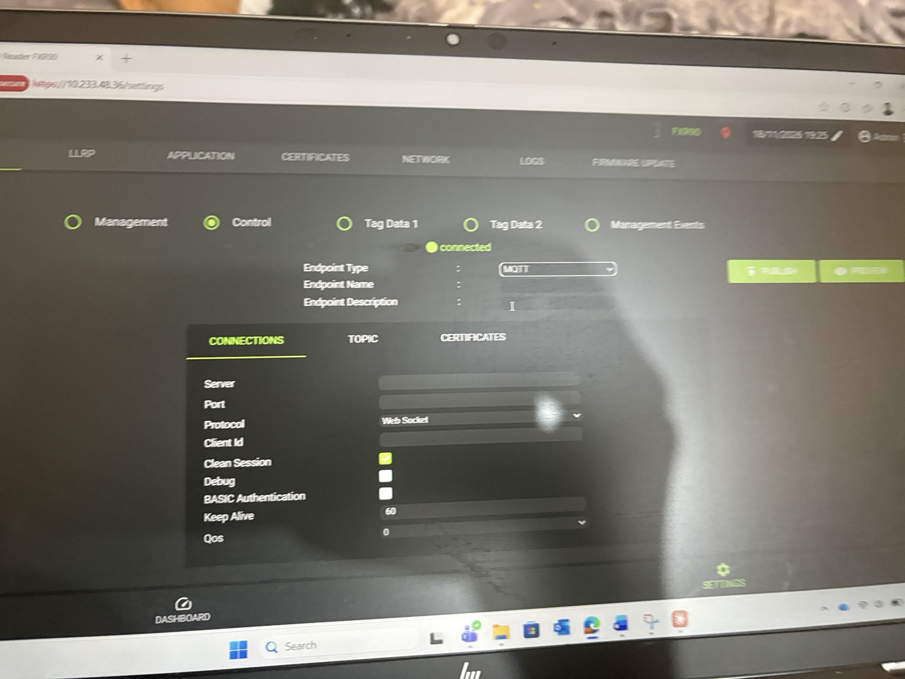
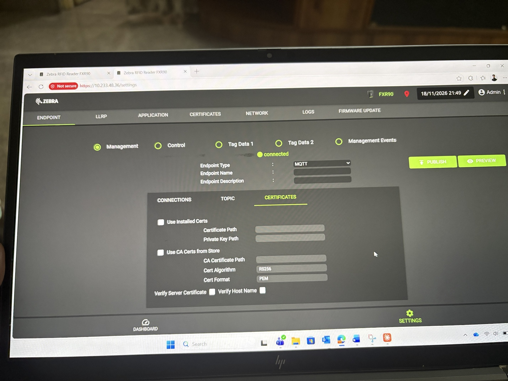

Configure an MQTT connection to exchange commands, responses, tag data, or management events with the reader.

:::note
In the web console, configure each interface separately, even if the interfaces use the same broker. Complete Steps 1–6 for each interface, then test the configured interfaces in Step 7.
:::

## Before You Begin

For each interface, obtain:

- Broker hostname or IP address, listening port, and protocol.
- MQTT client ID and broker credentials, if required.
- Topic names and the permissions needed to publish and subscribe.
- Certificates and private key, if required for a secure connection.
- Batching and retention values, if configuring Tag Data or Management Events.

Ensure that the reader can reach the broker over the network.

For API configuration, see [Configure Using the API](#configure-using-the-api).

## Step 1: Select the Interface

1. Sign in to the reader web console.
2. Go to **Settings > Endpoint**.
3. Select the interface you want to configure.


<p className="figure-caption"><strong>Figure 1:</strong> Select an interface on the Endpoint page.</p>

| If you want to… | Select |
| --- | --- |
| Configure or manage the reader | [Management](../introduction/ziotc-interfaces.mdx#management-interface) |
| Start or stop RFID inventory | [Control](../introduction/ziotc-interfaces.mdx#control-interface) |
| Send tag observations to an application | [Tag Data 1 or Tag Data 2](../introduction/ziotc-interfaces.mdx#data-interface) |
| Receive reader events, such as heartbeats and warnings | [Management Events](../introduction/ziotc-interfaces.mdx#management-events-interface) |

**Example:** To start reading tags and send observations to an application, configure both **Control** and a **Tag Data** interface.

Configure each interface your application needs separately. Each can use its own broker settings. For more information, see [ZIoTC Interfaces](../introduction/ziotc-interfaces.mdx).

4. Set **Endpoint Type** to **MQTT**.
5. Enter an **Endpoint Name** and **Endpoint Description**.

## Step 2: Configure the Connection

Select the **Connections** tab and enter the settings for the broker used by the selected interface.



<p className="figure-caption"><strong>Figure 2:</strong> MQTT connection settings for the selected interface.</p>

| Field | Description |
| --- | --- |
| **Server** | Enter the broker hostname or IP address. |
| **Port** | Enter the broker’s listening port for the selected protocol. |
| **Protocol** | Select the transport configured on the broker, such as TCP, TLS, Web Socket, or Secure WebSocket. |
| **Client Id** | Enter the identifier for this MQTT connection. Avoid using the same client ID for multiple active connections to the same broker. |
| **Clean Session** | Select the session behavior required by your application. |
| **Debug** | Enable when collecting connection information for troubleshooting. |
| **BASIC Authentication** | Enable and enter the username and password if required by the broker. |
| **Keep Alive** | Enter the keep-alive interval for the connection. |
| **Qos** | Select the quality of service required by your application and supported by the reader. |

Use the port configured on your broker. For example, MQTT over TCP commonly uses port `1883`, and MQTT over TLS commonly uses port `8883`.

## Step 3: Configure Topics

Select the **Topic** tab and configure the topics for the selected interface. The examples below are illustrative; use the topic names and permissions configured for your broker and application.

### Management Interface

| Field | Purpose | Example |
| --- | --- | --- |
| **Command Topic** | The reader subscribes to this topic to receive management commands. | `readers/reader-01/management/command` |
| **Response Topic** | The reader publishes management responses to this topic. | `readers/reader-01/management/response` |

### Control Interface

| Field | Purpose | Example |
| --- | --- | --- |
| **Command Topic** | The reader subscribes to this topic to receive control commands. | `readers/reader-01/control/command` |
| **Response Topic** | The reader publishes control responses to this topic. | `readers/reader-01/control/response` |

### Tag Data Interface

Configure the publish topic for the selected **Tag Data 1** or **Tag Data 2** interface.

| Field | Purpose | Example |
| --- | --- | --- |
| **Publish Topic** | The reader publishes tag observations to this topic. | `readers/reader-01/data/tags` |

### Management Events Interface

| Field | Purpose | Example |
| --- | --- | --- |
| **Publish Topic** | The reader publishes management events to this topic. | `readers/reader-01/events` |

## Step 4: Configure Certificates

:::note
Complete this step if you selected **TLS** or **Secure WebSocket**. Otherwise, continue to Step 5.
:::

Select the **Certificates** tab and configure the certificates required by the broker for the selected interface.

If the broker requires client certificate authentication, choose **Option A** or **Option B**.

### Option A: Use Installed Certificates

1. Select **Use Installed Certs**.
2. In the **Certificate** list, select the installed certificate required for the connection.


<p className="figure-caption"><strong>Figure 3:</strong> Certificate settings using installed certificates.</p>

### Option B: Use Certificate File Paths

1. Clear **Use Installed Certs**.
2. In **Certificate Path**, enter the absolute path to the client certificate.
3. In **Private Key Path**, enter the absolute path to the corresponding private key.



<p className="figure-caption"><strong>Figure 4:</strong> Certificate settings using file paths.</p>

### Configure the CA Certificate

Choose how to provide the CA certificate used to validate the broker:

- **Use the reader’s certificate store:** Select **Use CA Certs from Store**.
- **Use a certificate file:** Clear **Use CA Certs from Store** and enter the file’s absolute path in **CA Certificate Path**.

Check the **Cert Algorithm** and **Cert Format** values against your certificate configuration. Select **Verify Server Certificate** and **Verify Host Name**.

## Step 5: Configure Batching and Retention

:::note
This step applies to **Tag Data 1**, **Tag Data 2**, and **Management Events**. If you selected **Management** or **Control**, continue to Step 6.
:::

Select the **Batching and Retention** tab and enter the settings required for the selected interface.

For an explanation of these settings, see [Batching and Retention](./overview.mdx#batching-and-retention).


<p className="figure-caption"><strong>Figure 5:</strong> Batching and retention settings for Tag Data 1.</p>

Under **Batching**, configure:

| Field | Setting |
| --- | --- |
| **Reporting Interval (in milliseconds)** | Enter the reporting interval. |
| **Max Payload Size (in bytes)** | Enter the maximum payload size. |

Under **Retention**, configure:

| Field | Setting |
| --- | --- |
| **Throttle (in events per second)** | Enter the throttle value. |
| **No. of Events** | Enter the number of events to retain. |
| **Event Retention Time (in minutes)** | Enter the event retention time. |

## Step 6: Publish the Configuration

1. Confirm that the correct interface is selected.
2. Select **Preview** and review the connection, topic, certificate, and applicable batching and retention settings.
3. Select **Publish** to apply the configuration.
4. Check that the selected interface shows **connected**.

## Step 7: Verify Communication

You can use an MQTT client to test the reader connection. This procedure uses **MQTTX** as an example. If you use another client, follow its instructions to connect, subscribe, and publish messages.

### Before You Begin

- Configure and publish the interfaces you want to test.
- Obtain the broker address, port, credentials, and topic names for each interface.
- Confirm that your computer can reach the broker.
- To test tag data, configure both a **Control** interface and a **Tag Data** interface.

### Connect MQTTX to the Broker

1. Download and install [MQTTX](https://mqttx.app/).
2. Open MQTTX and create a new connection.
3. Enter the broker address and port configured for the interface you want to test.
4. Enter a unique client ID for MQTTX. Configure authentication and TLS certificates if the broker requires them.
5. Select **Connect**.

If interfaces use different brokers, create a separate MQTTX connection for each broker.

### Subscribe to the Reader Topics

In MQTTX, select **New Subscription** and subscribe to the topics you want to monitor:

| Interface | Subscribe to |
| --- | --- |
| **Management** | Management response topic |
| **Control** | Control response topic |
| **Tag Data 1 / Tag Data 2** | Tag Data publish topic |
| **Management Events** | Management Events publish topic |

Use the topic names configured on your reader. Subscribe through the MQTTX connection for the broker used by each interface.

### Test Management

Publish a supported management command to the **Management command topic**. Confirm that a response appears on the Management response topic.

For example, send [`get_status`](https://immanuel2504.github.io/fxr60-90-rest-mqtt/mqtt/docs/index.html#op-get_status):

```json
{
  "command": "get_status",
  "command_id": "test-status-01",
  "payload": {}
}
```

### Test Control and Tag Data

To start inventory, receive a tag observation, and stop inventory, follow [Quickstart: Read a Tag and Send Data through MQTT](../getting-started/quickstart-first-tag-to-mqtt-in-15-minutes.mdx).

### Test Management Events

1. Confirm that MQTTX is subscribed to the **Management Events publish topic**.
2. Wait for an enabled event, such as a configured heartbeat.
3. Confirm that the event appears in MQTTX. See the [Heartbeat reference](https://immanuel2504.github.io/fxr60-90-rest-mqtt/mqtt/docs/index.html#op-heartbeat).

:::note
If Tag Data is configured for HTTP POST instead of MQTT, check the configured HTTP server for tag data.
:::

The **connected** status confirms the broker connection. Receiving the expected response, tag data, or event confirms the message flow.

**REST API:** Use [`GET /cloud/status`](https://techdocs.zebra.com/dcs/rfid/fxr-api-docs/rest/docs/swagger#/System/getStatus) to check reader status or [`PUT /cloud/start`](https://techdocs.zebra.com/dcs/rfid/fxr-api-docs/rest/docs/swagger#/Control/startInventory) to start inventory.

To configure another interface, select it and repeat **Steps 1–6** using its broker settings, then perform the applicable verification above.

<span id="api-option-configure-an-mqtt-endpoint" />
<span id="rest-api-option-configure-mqtt-endpoints" />

## Configure Using the API

Use an MQTT command or the local REST API as an alternative to Steps 1–6. You can configure the broker connection, topics, and, where applicable, certificates, batching, and retention.

- **MQTT** — If the reader's **Management** interface is already connected to a broker, send [`set_importCloudConfig`](https://immanuel2504.github.io/fxr60-90-rest-mqtt/mqtt/docs/index.html#op-set_importCloudConfig) to the Management command topic.
- **Local REST API** — Send the configuration directly to the reader using [`PUT /cloud/cloudConfig`](https://techdocs.zebra.com/dcs/rfid/fxr-api-docs/rest/docs/swagger#/System/setImportcloudconfig).

After applying the settings, continue to [Step 7: Verify Communication](#step-7-verify-communication).
