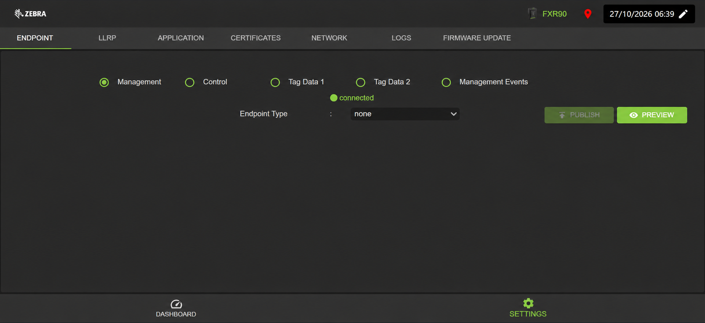
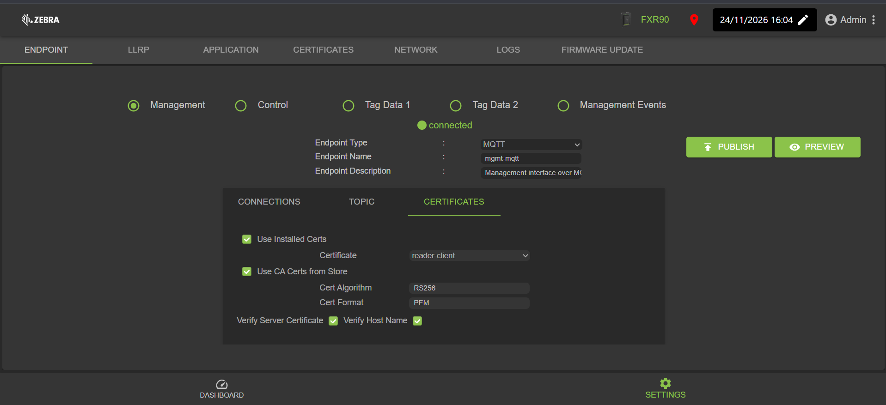

import MqttDiagram from './images/mqtt-communication.png';

Configure an MQTT connection to exchange commands, responses, tag observations, and management events between the reader and applications through an MQTT broker.

<a href={MqttDiagram} aria-label="Open the MQTT communication illustration at full size">
  
</a>

<p className="figure-caption"><strong>Figure 1:</strong> Example MQTT communication between the reader, broker, and application. <a href={MqttDiagram}>View full size</a>.</p>

Transport options are described in [Step 2](#step-2-configure-the-connection).

:::note
In the web console, configure each interface separately, even if the interfaces use the same broker. Complete Steps 1–6 for each interface, then test the configured interfaces in Step 7.
:::

## Before You Begin

Ensure that you can access the reader web console and that the reader can reach the broker. For each interface you intend to configure, obtain:

- The broker hostname or IP address, listening port, and transport protocol.
- An MQTT client ID and authentication credentials, if required.
- Topic names and the required publish and subscribe permissions.
- Batching and retention settings, if configuring Tag Data or Management Events.

For a secure connection, make the trusted CA certificate available to the reader. If the broker requires client certificate authentication, also obtain the client certificate and its corresponding private key.

To verify communication, have a compatible MQTT client available. For API configuration, see [Configure Using the API](#configure-using-the-api).

Select a screenshot to enlarge it.

## Step 1: Select the Interface

1. Sign in to the reader web console.
2. Go to **Settings > Endpoint**.
3. Select the interface you want to configure.



<p className="figure-caption"><strong>Figure 2:</strong> Illustration of the Endpoint page before selecting MQTT.</p>

| If you want to… | Select |
| --- | --- |
| Configure or manage the reader | [Management](../introduction/ziotc-interfaces.mdx#management-interface) |
| Start or stop RFID inventory | [Control](../introduction/ziotc-interfaces.mdx#control-interface) |
| Send tag observations to an application | [Tag Data 1 or Tag Data 2](../introduction/ziotc-interfaces.mdx#data-interface) |
| Receive reader events, such as heartbeats and warnings | [Management Events](../introduction/ziotc-interfaces.mdx#management-events-interface) |

4. Set **Endpoint Type** to **MQTT**.
5. Enter an **Endpoint Name** and **Endpoint Description**.

**Example:** To start reading tags and send observations to an application, configure both **Control** and a **Tag Data** interface. For more information, see [ZIoTC Interfaces](../introduction/ziotc-interfaces.mdx).

## Step 2: Configure the Connection

1. Select the **Connections** tab.
2. Enter the broker and MQTT session settings for the selected interface.


<p className="figure-caption"><strong>Figure 3:</strong> MQTT connection settings for the selected interface.</p>

| Field | Description | Example |
| --- | --- | --- |
| **Server** | Enter the broker hostname or IP address. | `mqtt.example.com` |
| **Port** | Enter the broker's listening port for the selected protocol. | `8883` |
| **Protocol** | Select the transport configured on the broker. See [Transport Selection](#transport-selection). | TLS |
| **Client Id** | Enter a unique identifier for this MQTT connection. | `reader-01-management` |
| **Clean Session** | Select to start a new session on connection. Clear to request a persistent session. | Selected |
| **Debug** | Select to enable diagnostic logging for troubleshooting. | Cleared |
| **BASIC Authentication** | Select and enter credentials if the broker requires them. | As required |
| **Keep Alive** | Specify the interval between MQTT control packets sent by the client. | `60` seconds |
| **Qos** | Select the quality of service required by your application. | `1` |

### Transport Selection

Select the protocol configured on your broker:

| Protocol | Description | Common port |
| --- | --- | --- |
| **TCP** | MQTT over an unencrypted TCP connection. | `1883` |
| **TLS** | MQTT over a TLS-encrypted connection. | `8883` |
| **Web Socket** | MQTT over an unencrypted WebSocket connection. | Broker-specific |
| **Secure WebSocket** | MQTT over a TLS-encrypted WebSocket connection. | `443` is common |

Use the port configured on your broker. If you select **TLS** or **Secure WebSocket**, complete [Step 4](#step-4-configure-certificates). Use a different client ID for each active connection to the same broker, including connections from different reader interfaces. These examples are illustrative, not reader defaults.

## Step 3: Configure Topics

1. Select the **Topic** tab.
2. Enter the topics for the selected interface. Management and Control use command and response topics; Tag Data and Management Events use publish topics.


<p className="figure-caption"><strong>Figure 4:</strong> Management command and response topic settings.</p>

The examples are illustrative. Use the topic names required by your application and ensure the reader has the necessary broker permissions.

### Management Interface

| Field | Description | Example |
| --- | --- | --- |
| **Command Topic** | The topic the reader subscribes to for management commands. | `readers/reader-01/management/command` |
| **Response Topic** | The topic the reader uses to publish management responses. | `readers/reader-01/management/response` |

### Control Interface

| Field | Description | Example |
| --- | --- | --- |
| **Command Topic** | The topic the reader subscribes to for control commands. | `readers/reader-01/control/command` |
| **Response Topic** | The topic the reader uses to publish control responses. | `readers/reader-01/control/response` |

### Tag Data Interface

Configure the publish topic for the selected **Tag Data 1** or **Tag Data 2** interface.

| Field | Description | Example |
| --- | --- | --- |
| **Publish Topic** | The topic the reader uses to publish tag observations. | `readers/reader-01/data/tags1` |

If both Tag Data interfaces are configured, use distinct topics when your application needs to distinguish the data streams.

### Management Events Interface

| Field | Description | Example |
| --- | --- | --- |
| **Publish Topic** | The topic the reader uses to publish management events. | `readers/reader-01/events` |

## Step 4: Configure Certificates

:::note
Complete this step if you selected **TLS** or **Secure WebSocket**. Otherwise, continue to Step 5.
:::

Ensure that the required certificates are installed on the reader or available at paths accessible to the reader. Select the **Certificates** tab.

### Configure Client Identity

If the broker requires client certificate authentication, configure the client certificate and its corresponding private key using one of the following options. Otherwise, continue to [Configure Trusted CA Certificates](#configure-trusted-ca-certificates).

#### Option A: Use Installed Certificates

Use this option if the required client certificate and private key are already installed on the reader.

For PFX installation, see [Install Certificates Using PFX](../security/certificate-management/install-certificates-using-pfx.mdx).


<p className="figure-caption"><strong>Figure 5:</strong> Using an installed certificate.</p>

1. Select **Use Installed Certs**.
2. In the **Certificate** list, select the required certificate.



<p className="figure-caption"><strong>Figure 6:</strong> Certificate settings using installed certificates.</p>

#### Option B: Use Certificate File Paths

Use this option if the client certificate and private key are available as individual files on the reader.


<p className="figure-caption"><strong>Figure 7:</strong> Using certificate file paths.</p>

For example, SCP can be used where supported. Use the file paths available on your reader.

For file transfer, see [Transfer Certificate Files Using SCP](../security/certificate-management/transfer-certificate-files-using-scp.mdx) (topic in preparation).

1. Clear **Use Installed Certs**.
2. In **Certificate Path**, enter the absolute path to the client certificate.
3. In **Private Key Path**, enter the absolute path to the corresponding private key.


<p className="figure-caption"><strong>Figure 8:</strong> Illustration of certificate settings with example file paths.</p>

The paths shown are examples. Enter the actual paths to files accessible to the reader, not paths on your computer.

<span id="configure-the-ca-certificate" />

### Configure Trusted CA Certificates

Choose how to provide the trusted CA certificate used to validate the broker:

- **CA certificate store:** Select **Use CA Certs from Store** when the required CA certificate is in the reader's trusted store.
- **CA certificate file:** Clear **Use CA Certs from Store** and enter its absolute path in **CA Certificate Path**.

Check **Cert Algorithm** and **Cert Format** against your certificate configuration.

### Configure Server Verification

Select **Verify Server Certificate** to validate the broker's certificate against the configured trust source. Select **Verify Host Name** to check that the broker address matches its certificate. Keep both options selected for secure production connections.

## Step 5: Configure Batching and Retention

:::note
This step applies to **Tag Data 1**, **Tag Data 2**, and **Management Events**. If you selected **Management** or **Control**, continue to Step 6.
:::

Select the **Batching and Retention** tab and enter the settings required for the selected interface. For an explanation, see [Batching and Retention](./overview.mdx#batching-and-retention).


<p className="figure-caption"><strong>Figure 9:</strong> Batching and retention settings for Tag Data 1.</p>

### Configure Batching

Batching groups events into payloads for delivery to the broker.

| Field | Description |
| --- | --- |
| **Reporting Interval (in milliseconds)** | Specify the interval used to report batched events. |
| **Max Payload Size (in bytes)** | Specify the maximum payload size for a batch of events. |

### Configure Retention

Retention settings control the event rate and the limits for retaining events on the reader.

| Field | Description |
| --- | --- |
| **Throttle (in events per second)** | Specify the event rate. |
| **No. of Events** | Specify the number of events to retain. |
| **Event Retention Time (in minutes)** | Specify how long events can be retained. |

Choose values based on your application's event volume and latency requirements and the reader's supported limits.

<span id="step-6-publish-the-configuration" />

## Step 6: Preview and Publish

1. Confirm that the intended interface is selected.
2. Select **Preview** and review the configured settings.
3. Select **Publish** to apply the configuration.
4. Verify that the selected interface shows **connected**.


<p className="figure-caption"><strong>Figure 10:</strong> Preview and publish controls and connection status.</p>

If it does not connect, check the broker address and port, network access, credentials, and any certificate settings.

## Step 7: Verify Communication

Use a compatible MQTT client to verify that the reader exchanges messages through the broker. This procedure uses [MQTTX](https://mqttx.app/) as an example; if you use another client, follow its instructions to connect, subscribe, and publish messages.

Follow the checks for the interfaces you configured.

### Connect to the MQTT Broker

1. Open MQTTX and create a new connection.
2. Enter the broker address, port, protocol, and authentication settings. Use a client ID different from those used by the reader. If the broker requires mutual TLS, use authorized client credentials for MQTTX.
3. Select **Connect**.

If interfaces use different brokers, create a separate MQTTX connection for each broker.

### Subscribe to a Topic

1. Select **New Subscription**.
2. Enter the response or publish topic configured for the selected interface in Step 3.
3. Confirm the subscription.


<p className="figure-caption"><strong>Figure 11:</strong> MQTTX subscription dialog with an example topic. Source: <a href="https://mqttx.app/docs/get-started">MQTTX documentation</a>.</p>

### Check the Reader Version (Management)

If you configured **Management**, use the following example to request reader version information. Subscribe to the Management response topic before sending the command.

| Topic | Example |
| --- | --- |
| Command Topic | `readers/reader-01/management/command` |
| Response Topic | `readers/reader-01/management/response` |

1. In the publishing area, enter the configured Management command topic.
2. Select **JSON** as the payload format and ensure **Retain** is disabled.
3. Enter the following request and select **Send**:

   ```json
   {
     "command": "get_version",
     "command_id": "req-version-01",
     "payload": {}
   }
   ```

4. Check the Management response topic. The response should contain the same `command_id` as the request. For example:

   ```json
   {
     "command": "get_version",
     "command_id": "req-version-01",
     "response": "success",
     "payload": {
       "readerApplication": "2.0.7-5",
       "radioFirmware": "2.1.57.0"
     }
   }
   ```

   This is a shortened example; the version values and other fields depend on the reader. See the [`get_version` reference](https://zebra-stage.github.io/dcs/rfid/fxr-api-docs/mqtt/docs/#op-get_version).

### Start RFID Inventory (Control)

If you configured **Control**, configure an RFID operating mode and enable an antenna. Subscribe to the Control response topic before publishing commands. To receive tag observations, also configure a Tag Data interface and subscribe to its topic. See the [MQTT Quickstart](../getting-started/quickstart-first-tag-to-mqtt-in-15-minutes.mdx).

| Topic | Example |
| --- | --- |
| Control command | `readers/reader-01/control/command` |
| Control response | `readers/reader-01/control/response` |
| Tag Data | `readers/reader-01/data/tags1` |

Use the topics configured on your reader. In MQTTX, publish each request to the **Control command** topic and check its response on the **Control response** topic.

**Start request:**

```json
{
  "command": "start",
  "command_id": "req-start-01",
  "payload": { "doNotPersistState": true }
}
```

**Example start response:**

```json
{
  "command": "start",
  "command_id": "req-start-01",
  "response": "success",
  "payload": {}
}
```

### Example: Tag Data in MQTTX

If you configured a **Tag Data** interface, present a tag to the antenna after starting inventory. MQTTX displays the observation on the subscribed Tag Data topic.


<p className="figure-caption"><strong>Figure 12:</strong> Illustration of a tag observation received in MQTTX.</p>

In this example, `readers/reader-01/data/tags1` is the topic from Step 3, `idHex` is the tag identifier, and `antenna` identifies the antenna that read the tag. Topic names and message contents depend on your configuration.

### Stop RFID Inventory (Control)

When you have finished reading tags, publish the following request to the Control command topic.

**Stop request:**

```json
{
  "command": "stop",
  "command_id": "req-stop-01",
  "payload": {}
}
```

**Example stop response:**

```json
{
  "command": "stop",
  "command_id": "req-stop-01",
  "response": "success",
  "payload": {}
}
```

Use a new `command_id` for each request and match it to the response. If the response is `failure`, check its payload for error details. See the [`start`](https://zebra-stage.github.io/dcs/rfid/fxr-api-docs/mqtt/docs/#op-start) and [`stop`](https://zebra-stage.github.io/dcs/rfid/fxr-api-docs/mqtt/docs/#op-stop) references.

### Verify Management Events

If you configured **Management Events**, subscribe to its publish topic and confirm that an enabled event, such as a heartbeat, is received.

The **connected** status confirms the broker connection. Receiving the expected response, tag data, or event confirms the message flow. To configure another interface, repeat Steps 1–6 using its settings, then perform the applicable verification above.

<span id="api-option-configure-an-mqtt-endpoint" />
<span id="rest-api-option-configure-mqtt-endpoints" />

## Configure Using the API

Use an MQTT command or the local REST API as an alternative to Steps 1–6. You can configure the broker connection, topics, and, where applicable, certificates, batching, and retention.

| API | Configuration Method |
| --- | --- |
| **Local REST API** | Send the configuration directly to the reader using [`PUT /cloud/cloudConfig`](https://zebra-stage.github.io/dcs/rfid/fxr-api-docs/rest/docs/swagger.html#/System/setImportcloudconfig). |
| **MQTT** | Send [`set_importCloudConfig`](https://zebra-stage.github.io/dcs/rfid/fxr-api-docs/mqtt/docs/#op-set_importCloudConfig) with the endpoint configuration to the Management command topic. |

:::note
To configure endpoints using MQTT, the reader's **Management** interface must already be connected to an MQTT broker.
:::

After applying the settings, continue to [Step 7: Verify Communication](#step-7-verify-communication).
