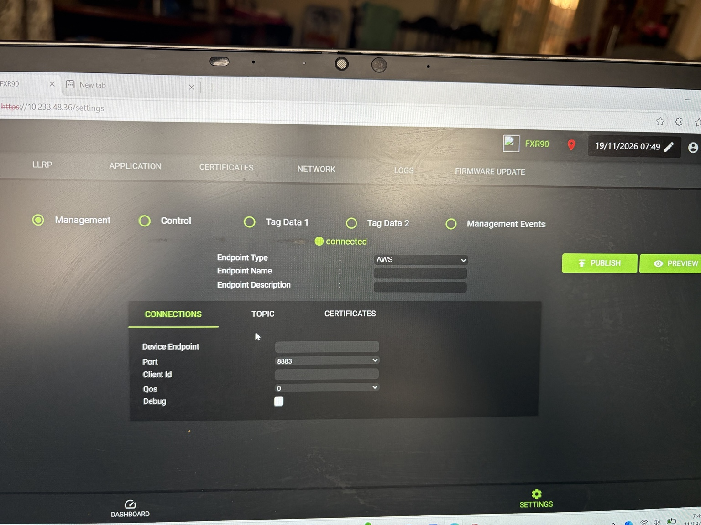
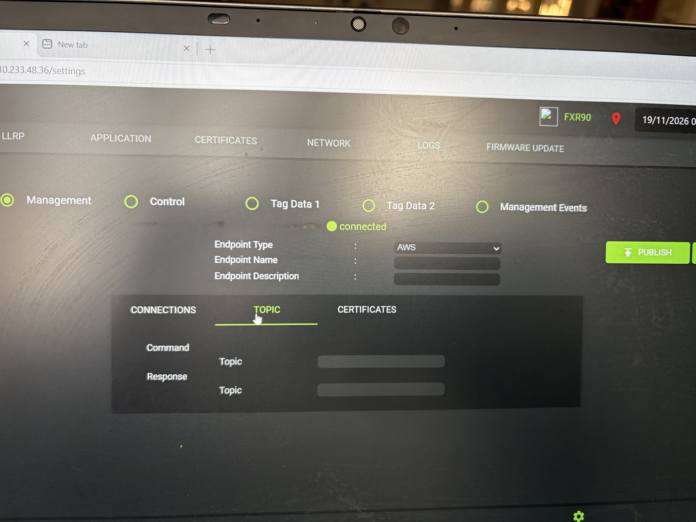
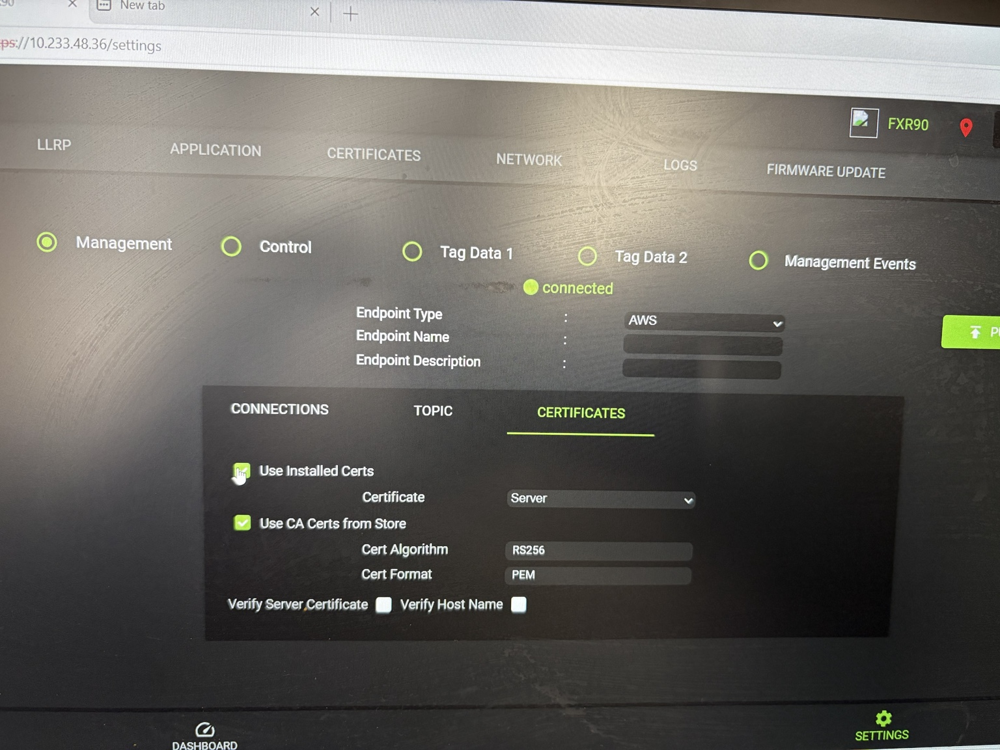
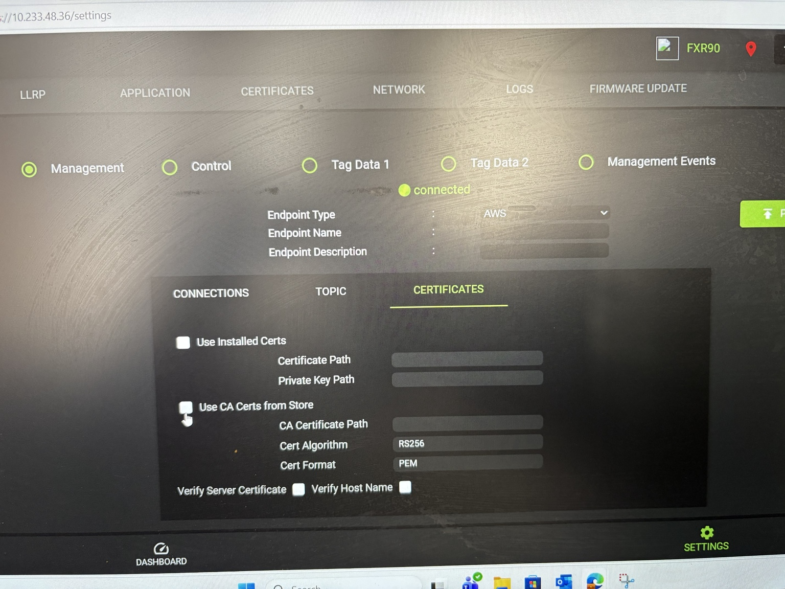

Connect a reader interface to AWS IoT Core or Azure IoT Hub to exchange commands, responses, tag data, or management events with an application.

:::note
Configure each interface separately, even if the interfaces use the same cloud service. Complete Steps 1–7 for one interface before selecting another.
:::

## Before You Begin

Ensure the reader can reach the cloud service. Obtain the endpoint hostname, the device identity, the topic names, and the credentials required for the selected interface. Prepare the certificates and private key when certificate authentication is required.

- **AWS IoT Core:** Obtain the device data endpoint for your account and Region, an active registered device certificate and its private key, and a trusted CA certificate. Attach an AWS IoT policy to the certificate that permits the required connection and topic operations. Find the device data endpoint under **Settings** in the AWS IoT Core console. See [Connect devices to AWS IoT](https://docs.aws.amazon.com/iot/latest/developerguide/iot-connect-devices.html) and [Attach a policy to a client certificate](https://docs.aws.amazon.com/iot/latest/developerguide/attach-to-cert.html).
- **Azure IoT Hub:** Obtain the IoT hub hostname and a registered device identity with the credentials required by its configured authentication method. Check the reader and hub support the intended connection profile and topic operations. See [Use MQTT to communicate with Azure IoT Hub](https://learn.microsoft.com/en-us/azure/iot-hub/iot-hub-mqtt-support).

## Step 1: Select the Interface

1. Sign in to the reader web console.
2. Go to **Settings > Endpoint**.
3. Select the interface you want to configure:

| Interface | Purpose |
| --- | --- |
| **Management** | Configure and administer the reader. |
| **Control** | Control RFID operations, including starting and stopping reading. |
| **Tag Data 1 / Tag Data 2** | Send tag observations to an application. |
| **Management Events** | Send events such as heartbeats, GPIO events, errors, and warnings. |

4. Set **Endpoint Type** to the option for your cloud service: **AWS** for AWS IoT Core or the Azure IoT Hub option for Azure.
5. Enter an **Endpoint Name** and **Endpoint Description**.

## Step 2: Configure the Connection

Select the **Connections** tab and enter the settings for the selected cloud service and interface.

*Figure 1: AWS connection settings for the Management interface. Azure fields may differ.*

| Setting | What to enter |
| --- | --- |
| **Endpoint** | Enter the AWS device data endpoint or Azure IoT hub hostname. The AWS screen labels this field **Device Endpoint**. |
| **Port** | Select the port required by the service and connection. The AWS screen shows `8883`. |
| **Client Id** | Enter the identity required by the service and authorized for this connection. |
| **Qos** | Select the quality of service supported by the reader and required by the application. |
| **Debug** | Enable when collecting connection information for troubleshooting. |

**AWS:** Use a client ID allowed by the AWS IoT policy. Some thing associations and policies require the ID to match the thing name. AWS IoT Core does not keep simultaneous connections with the same client ID. Ensure the policy and device identities support the connections you intend to use. See [Associating a thing to a connection](https://docs.aws.amazon.com/iot/latest/developerguide/exclusive-thing.html).

**Azure:** For a direct MQTT device connection using the classic IoT Hub profile, use the registered device ID as the client ID and configure the authentication required by that identity. IoT Hub closes an existing connection when a new connection uses the same device ID; plan separate identities if the interfaces make simultaneous independent connections. Check the Azure fields and supported authentication on your reader. See [Use MQTT to communicate with Azure IoT Hub](https://learn.microsoft.com/en-us/azure/iot-hub/iot-hub-mqtt-support).

## Step 3: Configure Topics

Select the **Topic** tab and enter the topics for the selected interface. Ensure that the cloud service, device permissions, and application support the configured message flow.

*Figure 2: AWS topic settings for the Management interface.*

| Interface | Topic purpose |
| --- | --- |
| **Management** | Receive management commands and publish responses. |
| **Control** | Receive control commands and publish responses. |
| **Tag Data 1 / Tag Data 2** | Publish tag observations. |
| **Management Events** | Publish management events. |

**AWS:** Use the command, response, data, and event topic names authorized by your AWS IoT policy and used by your application. For example, a Management interface could use `readers/reader-01/management/command` and `readers/reader-01/management/response`.

**Azure:** Use the topic formats supported by your IoT Hub connection profile and device identity. For example, classic IoT Hub device telemetry uses `devices/{device-id}/messages/events/`, replacing `{device-id}` with the registered device ID. Classic IoT Hub is not a general-purpose MQTT broker; do not assume that the AWS example topics work with Azure. See [IoT Hub MQTT topic support](https://learn.microsoft.com/en-us/azure/iot-hub/iot-hub-mqtt-support).

## Step 4: Configure Certificates

Install the required device certificate on the reader or make the certificate and private key files available at the paths you will enter. Select the **Certificates** tab and configure the credentials and trusted CA certificate required by your cloud service and authentication method.

### Option A: Use Installed Certificates

1. Select **Use Installed Certs**.
2. In the **Certificate** list, select the installed certificate required for the connection.

*Figure 3: AWS certificate settings using an installed certificate.*

### Option B: Use Certificate File Paths

1. Clear **Use Installed Certs**.
2. In **Certificate Path**, enter the absolute path to the device certificate.
3. In **Private Key Path**, enter the absolute path to the corresponding private key.

*Figure 4: AWS certificate settings using file paths.*

### Configure the CA Certificate

- To use the reader’s certificate store, select **Use CA Certs from Store**.
- To use a certificate file, clear **Use CA Certs from Store** and enter its absolute path in **CA Certificate Path**.

Check **Cert Algorithm** and **Cert Format** against your certificate configuration. Select **Verify Server Certificate** and **Verify Host Name**. If Azure uses another authentication method, configure its credentials as required for that identity; certificate authentication and SAS authentication have different requirements.

## Step 5: Configure Batching and Retention

:::note
This step applies to **Tag Data 1** and **Tag Data 2**. For other interfaces, continue to Step 6.
:::

Select the **Batching and Retention** tab and enter the settings required for the selected Tag Data interface.

| Section | Field | Setting |
| --- | --- | --- |
| Batching | **Reporting Interval (in milliseconds)** | Enter the reporting interval. |
| Batching | **Max Payload Size (in bytes)** | Enter the maximum payload size. |
| Retention | **Throttle (in events per second)** | Enter the throttle value. |
| Retention | **No. of Events** | Enter the number of events to retain. |
| Retention | **Event Retention Time (in minutes)** | Enter the event retention time. |

## Step 6: Publish the Configuration

1. Confirm that the correct interface is selected.
2. Select **Preview** and review the connection, topic, certificate, and applicable batching and retention settings.
3. Select **Publish** to apply the configuration.
4. Check that the selected interface shows **connected**.

## Step 7: Verify Communication

Set up the cloud-side receiver **before** triggering a message.

- **AWS:** In the AWS IoT console, open **Test > MQTT test client** and subscribe to the configured response or event topic. See [View MQTT messages](https://docs.aws.amazon.com/iot/latest/developerguide/view-mqtt-messages.html).
- **Azure:** Monitor the IoT hub’s configured telemetry destination or use the Azure CLI monitoring workflow for the applicable hub. See [Monitor device telemetry using the Azure CLI](https://learn.microsoft.com/en-us/azure/iot-hub/quickstart-send-telemetry-cli).

| Interface | Verification |
| --- | --- |
| **Management** | Send a supported management command and confirm the response arrives. |
| **Control** | Send a supported control command and confirm the response and resulting reader state. |
| **Tag Data 1 / Tag Data 2** | Start RFID inventory, present a tag, and confirm that tag data arrives. |
| **Management Events** | Wait for or trigger an enabled event, such as a configured heartbeat, and confirm it arrives. |

Use a cloud-side method supported by your integration to send commands and receive responses. The **connected** status confirms the connection; receiving the expected response, tag data, or event confirms the message flow.

Repeat the procedure for each additional interface.
