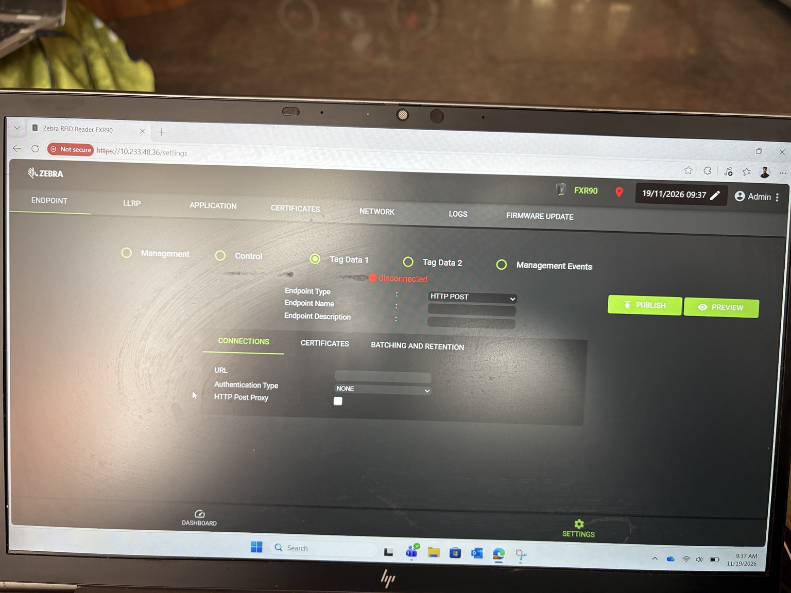
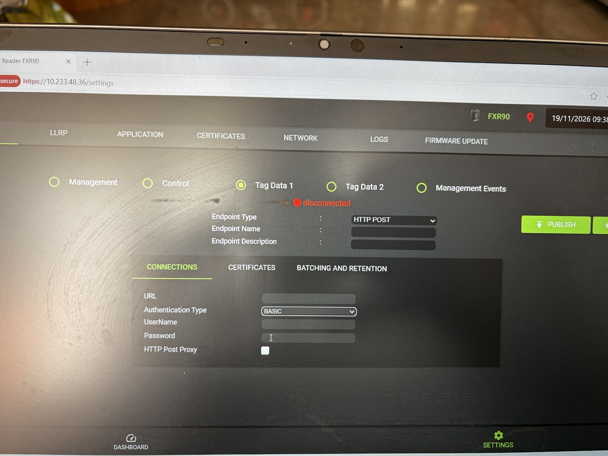
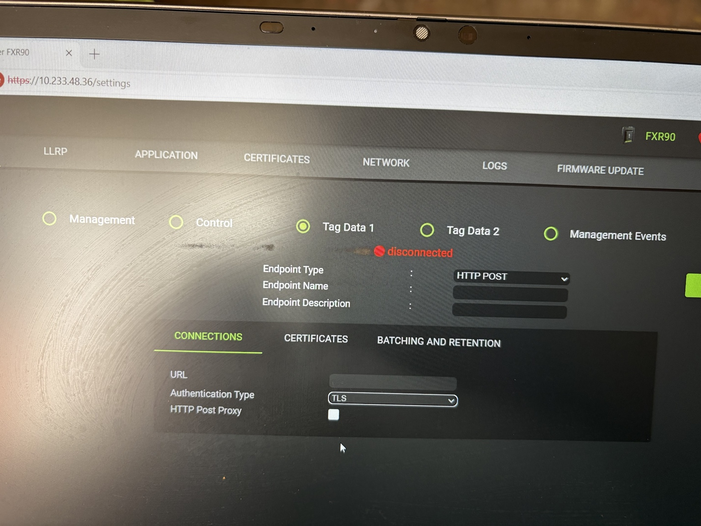
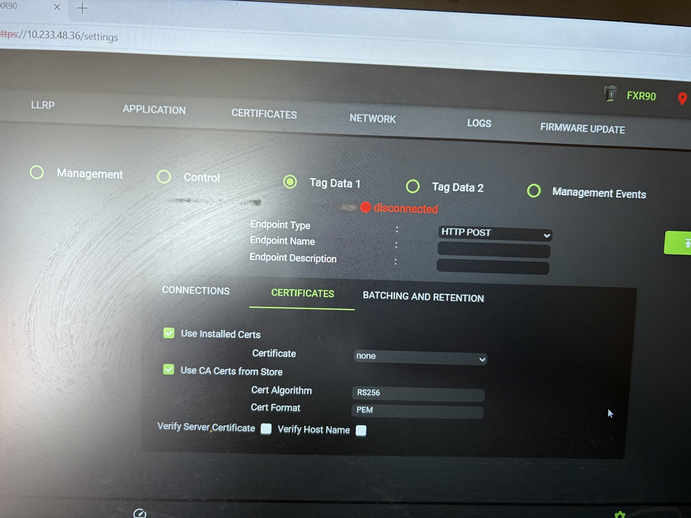
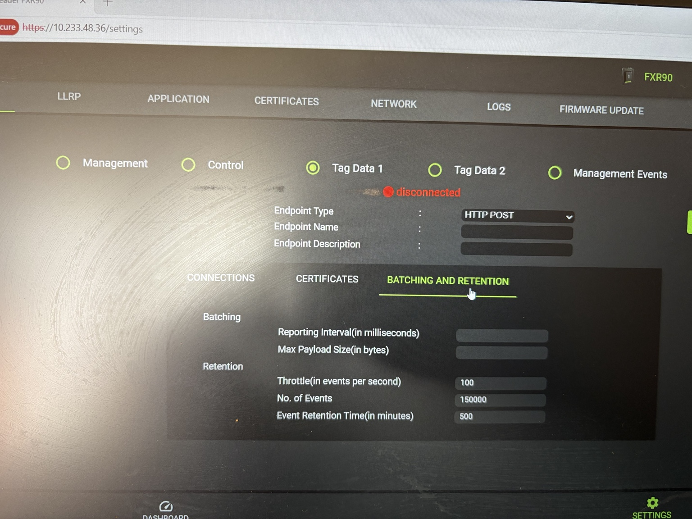

{/* TOC topic 4.5 | Type: Task */}

## HTTP POST

Configure an HTTP POST endpoint to send tag data or management events from the reader to a web server.

:::note
Configure each interface separately, even if the interfaces use the same destination. Complete Steps 1–6 for one interface before selecting another.
:::

### Before You Begin

Obtain:

- The destination server’s HTTP or HTTPS URL.
- Authentication details, if required by the server.
- Certificates required for a secure connection.
- Proxy settings, if the connection uses an HTTP POST proxy.

Ensure that the reader can reach the destination server.

### Step 1: Select the Interface

1. Sign in to the reader web console.
2. Go to **Settings > Endpoint**.
3. Select the interface you want to configure:

| Interface | Purpose |
| --- | --- |
| **Tag Data 1 / Tag Data 2** | Send tag observations to the server. |
| **Management Events** | Send events such as heartbeats, GPIO events, errors, and warnings to the server. |

4. Set **Endpoint Type** to **HTTP POST**.
5. Enter an **Endpoint Name** and **Endpoint Description**.

### Step 2: Configure the Connection

Select the **Connections** tab and enter the settings for the selected interface.

*Figure 1: HTTP POST connection settings.*

| Field | Description |
| --- | --- |
| **URL** | Enter the destination server’s HTTP or HTTPS URL. |
| **Authentication Type** | Select the authentication type required by the server. |
| **HTTP Post Proxy** | Select this option if the connection requires a proxy, then enter the required proxy settings. |

#### Authentication Type

| Option | Configuration |
| --- | --- |
| **NONE** | Select when the destination does not require authentication. |
| **BASIC** | Enter the server credentials in **UserName** and **Password**. |
| **TLS** | Select when required by the destination, then configure the applicable settings on the **Certificates** tab. |

*Figure 2: Connection settings with BASIC authentication.*

*Figure 3: Connection settings with TLS authentication.*

### Step 3: Configure Certificates

For an HTTPS destination, select the **Certificates** tab and configure the certificates required by the server.

*Figure 4: Certificate settings for an HTTP POST endpoint.*

#### Option A: Use Installed Certificates

If the server requires a client certificate:

1. Select **Use Installed Certs**.
2. In the **Certificate** list, select the installed certificate required for the connection.

#### Option B: Use Certificate File Paths

If the server requires a client certificate and you are using certificate files:

1. Clear **Use Installed Certs**.
2. Enter the client certificate path in **Certificate Path**.
3. Enter the corresponding private key path in **Private Key Path**.

#### Configure the CA Certificate

Choose how to provide the trusted CA certificate used to validate the server:

- **Use the reader’s certificate store:** Select **Use CA Certs from Store**.
- **Use a certificate file:** Clear **Use CA Certs from Store** and enter its path in **CA Certificate Path**.

Check **Cert Algorithm** and **Cert Format** against your certificate configuration. Select **Verify Server Certificate** and **Verify Host Name**.

### Step 4: Configure Batching and Retention

For **Tag Data 1** or **Tag Data 2**, select the **Batching and Retention** tab and enter the settings for the selected interface.

*Figure 5: Batching and retention settings for Tag Data 1.*

#### Batching

| Field | Setting |
| --- | --- |
| **Reporting Interval (in milliseconds)** | Enter the reporting interval. |
| **Max Payload Size (in bytes)** | Enter the maximum payload size. |

#### Retention

| Field | Setting |
| --- | --- |
| **Throttle (in events per second)** | Enter the throttle value. |
| **No. of Events** | Enter the number of events to retain. |
| **Event Retention Time (in minutes)** | Enter the event retention time. |

### Step 5: Publish the Configuration

1. Confirm that the correct interface is selected.
2. Select **Preview** and review the connection, certificate, and applicable batching and retention settings.
3. Select **Publish** to apply the configuration.

### Step 6: Verify Delivery

Check the destination server for incoming HTTP POST requests. Trigger the applicable message:

| Interface | Verification |
| --- | --- |
| **Tag Data 1 / Tag Data 2** | Start RFID inventory, present a tag, and confirm that tag data reaches the server. |
| **Management Events** | Wait for or trigger an enabled event and confirm that it reaches the server. |

Repeat the procedure for each additional interface.

## TCP Server

{/* TODO */}

## WebSocket

{/* TODO */}
