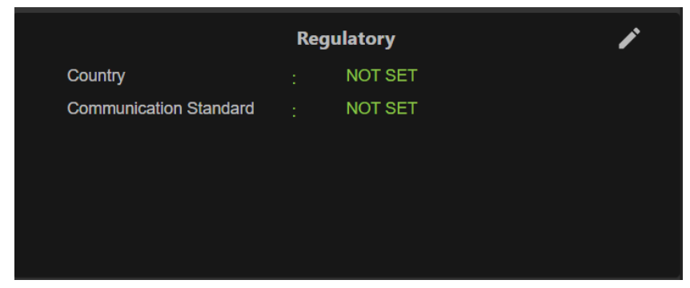
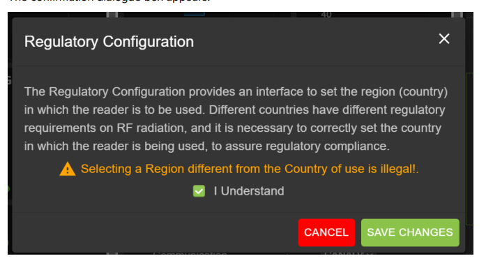
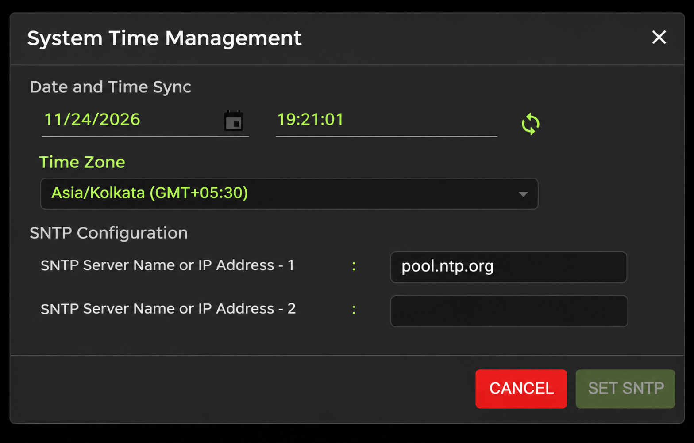

Before starting RFID operations, configure the reader's regulatory region, date, and time.

The regulatory region determines the permitted RFID operating frequencies and communication standards. Accurate date and time settings help ensure consistent timestamps in tag data, reader events, and diagnostic logs.

## Before You Begin

- Sign in to the reader web console with administrator privileges.
- Identify the country in which the reader will operate.

For sign-in instructions, see [Access the Reader Web Console](./discover-access-and-sign-in-to-the-reader.mdx).

## Step 1: Configure the Regulatory Region

For global reader configurations, set the regulatory region before starting RFID operations.

:::important
Select the country or region in which the reader is physically installed. Operating the reader under an incorrect regulatory region is illegal.
:::

:::note
Region configuration is not available on readers configured for operation in the United States under FCC rules. Skip this step for these readers.
:::

1. Locate the **Regulatory** section on the reader dashboard.
2. Click the pencil icon to open the regulatory settings editor.

<strong>Figure 1:</strong> Regulatory settings on the reader dashboard.

3. Configure the following settings:

   | Setting | Description |
   | --- | --- |
   | Region of Operation | Select the country or region where the reader will operate. |
   | Communication Standard | Select a communication standard supported by the selected region. If only one standard is supported, it is selected automatically. |
   | Channel Hopping | Enable channel hopping, if supported by the selected region. |
   | Operating Channels | Select the required operating channels from the supported channels, if applicable. |

4. Click the check icon to finalize the changes.

   The **Regulatory Configuration** confirmation dialog appears.

<strong>Figure 2:</strong> Regulatory configuration confirmation dialog.

5. Select **I Understand**.
6. Click **SAVE CHANGES**.

The **Regulatory** section displays the configured country and communication standard.

### API Option: Configure the Regulatory Region

Use MQTT or the local REST API to retrieve supported values, configure the region, and verify the setting.

| Action | MQTT command | Local REST API |
| --- | --- | --- |
| List supported regions | [`get_supportedRegionList`](https://zebra-stage.github.io/dcs/rfid/fxr-api-docs/mqtt/docs/#op-get_supportedRegionList) | [`GET /cloud/supportedRegionList`](https://zebra-stage.github.io/dcs/rfid/fxr-api-docs/rest/docs/swagger.html#/Region/getSupportedregionlist) |
| List standards for a region | [`get_supportedStandardList`](https://zebra-stage.github.io/dcs/rfid/fxr-api-docs/mqtt/docs/#op-get_supportedStandardList) | [`GET /cloud/supportedStandardList`](https://zebra-stage.github.io/dcs/rfid/fxr-api-docs/rest/docs/swagger.html#/Region/getSupportedstandardlist) |
| Configure the region | [`set_region`](https://zebra-stage.github.io/dcs/rfid/fxr-api-docs/mqtt/docs/#op-set_region) | [`PUT /cloud/region`](https://zebra-stage.github.io/dcs/rfid/fxr-api-docs/rest/docs/swagger.html#/Region/setRegion) |
| Verify the region | [`get_region`](https://zebra-stage.github.io/dcs/rfid/fxr-api-docs/mqtt/docs/#op-get_region) | [`GET /cloud/region`](https://zebra-stage.github.io/dcs/rfid/fxr-api-docs/rest/docs/swagger.html#/Region/getRegion) |

For MQTT, use a configured and connected **Management** interface. For local REST, authenticate with the reader and send requests directly to its HTTPS address. See the linked references for parameters and request bodies.

## Step 2: Configure the Date and Time

Configure the reader's date and time to ensure accurate timestamps in RFID tag data, reader events, and diagnostic logs.

1. Open the reader's **System Time Management** dialog from the date and time display.
2. Check the date and time under **Date and Time Sync** and select the appropriate **Time Zone**.
3. If your deployment uses network time synchronization, enter the server hostname or IP address supplied by your administrator under **SNTP Configuration**. Enter a second server if required, then click **SET SNTP**.
4. If setting the time manually, use the date and time controls provided by your reader and apply the change.
5. Confirm that the reader displays the correct date and time.

<strong>Figure 3:</strong> Illustration of the System Time Management dialog.

Accurate time helps the reader evaluate certificate validity for secure connections. Time settings and available synchronization methods can vary by model and firmware.

### API Option: Configure the Time Zone and Time Server

Use MQTT or the local REST API to configure and check the time zone and network time server, where supported by your reader and firmware.

| Action | MQTT command | Local REST API |
| --- | --- | --- |
| Set the time zone | [`set_timeZone`](https://zebra-stage.github.io/dcs/rfid/fxr-api-docs/mqtt/docs/#op-set_timeZone) | [`PUT /cloud/timeZone`](https://zebra-stage.github.io/dcs/rfid/fxr-api-docs/rest/docs/swagger.html#/Date%26Time/setTimezone) |
| Check the time zone | [`get_timeZone`](https://zebra-stage.github.io/dcs/rfid/fxr-api-docs/mqtt/docs/#op-get_timeZone) | [`GET /cloud/timeZone`](https://zebra-stage.github.io/dcs/rfid/fxr-api-docs/rest/docs/swagger.html#/Date%26Time/getTimezone) |
| Set the time server | [`set_ntpServer`](https://zebra-stage.github.io/dcs/rfid/fxr-api-docs/mqtt/docs/#op-set_ntpServer) | [`PUT /cloud/ntpServer`](https://zebra-stage.github.io/dcs/rfid/fxr-api-docs/rest/docs/swagger.html#/Date%26Time/updateNtpServer) |
| Check the time server | [`get_ntpServer`](https://zebra-stage.github.io/dcs/rfid/fxr-api-docs/mqtt/docs/#op-get_ntpServer) | [`GET /cloud/ntpServer`](https://zebra-stage.github.io/dcs/rfid/fxr-api-docs/rest/docs/swagger.html#/Date%26Time/getNtpServer) |

For MQTT, use the connected **Management** interface. For local REST, authenticate with the reader. After applying the settings, confirm that the reader displays the correct date and time.

## Step 3: Verify the Configuration

Verify that:

- The **Country** matches the reader's physical installation location.
- The **Communication Standard** is configured.
- The reader displays the correct date and time.

For model-specific configuration instructions, refer to the applicable Integration Guide:

- [FXR90 RFID Reader Integration Guide](https://docs.zebra.com/us/en/rfid/fxr90-rfid-reader-ig/c-fxr90-integration-guide.html)
- [FX7500 and FX9600 RFID Reader Integration Guide](https://www.zebra.com/content/dam/support-dam/en/documentation/unrestricted/guide/product/fxseries-ig-en.pdf)

For other reader models, refer to [Zebra RFID Support](https://www.zebra.com/us/en/support-downloads/rfid.html).

Continue to [Quickstart: Read Your First Tag over MQTT in 15 Minutes](./quickstart-first-tag-to-mqtt-in-15-minutes.mdx).
