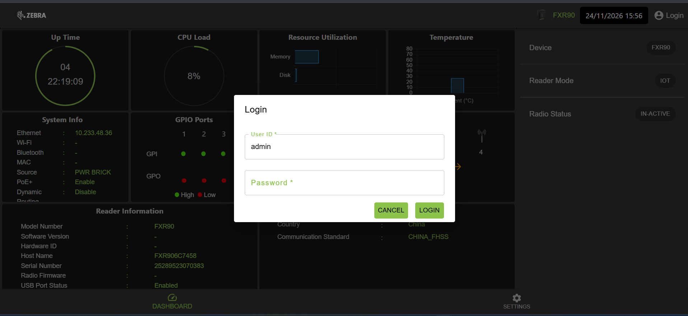

Use the reader web console to configure the reader, manage network connections, and configure RFID operations.

## Before You Begin

Ensure that:

- The reader is installed, powered on, and connected to the network.
- You know the reader's hostname or IP address.
- You have the credentials required to sign in to the reader.
- Your computer is connected to a network that can reach the reader.

For installation and discovery instructions, see [Prepare, Install, and Discover the Reader](./prerequisites-and-pre-installation-checklist.mdx).

## Step 1: Open the Reader Web Console

1. Open a supported web browser, such as Chrome, Firefox, Safari, or Edge.
2. Enter the reader's HTTPS address using its hostname or IP address.

   | Connection method | Example URL |
   | --- | --- |
   | Hostname | `https://FXR90CD3B0D` |
   | IP address | `https://192.168.1.105` |

   Replace the example hostname or IP address with the actual address of your reader.
3. Press **Enter**.

   The reader login page appears.

:::note
If the browser displays a certificate warning, verify the reader's address and follow your organization's security procedures for trusting the reader's certificate.
:::

## Step 2: Sign In and Update the Default Password

1. Enter your user ID and password.

   For a factory-default FXR90 reader, use the following credentials:

   | Field | Default value |
   | --- | --- |
   | User ID | `admin` |
   | Password | `change` |

<strong>Figure 1:</strong> Reader web console login dialog.

2. Click **Login**.
3. If prompted to change the default password, follow the on-screen instructions to set a new password.
4. Sign in using the new password if prompted.

After successful authentication, the reader web console appears.

:::note
Default credentials, password requirements, and login procedures may vary by reader model and firmware version.
:::

For model-specific instructions, refer to the applicable Integration Guide:

- [FXR90 RFID Reader Integration Guide](https://docs.zebra.com/us/en/rfid/fxr90-rfid-reader-ig/c-fxr90-integration-guide.html)
- [FX7500 and FX9600 RFID Reader Integration Guide](https://www.zebra.com/content/dam/support-dam/en/documentation/unrestricted/guide/product/fxseries-ig-en.pdf)

For other reader models, refer to [Zebra RFID Support](https://www.zebra.com/us/en/support-downloads/rfid.html).
