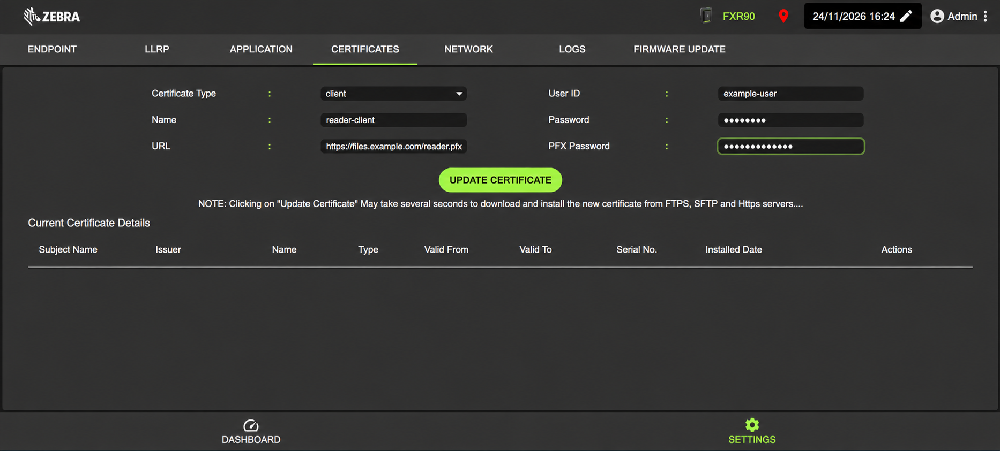
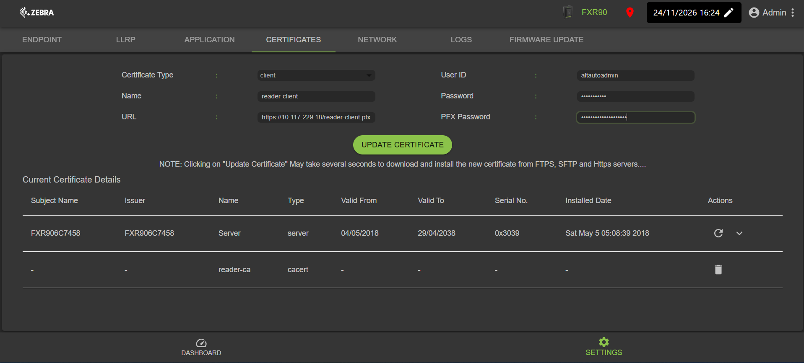

Install a client certificate and its private key on the reader using a password-protected PFX file. You can then select the installed certificate for a secure endpoint.

## Before You Begin

Obtain:

- A PFX file containing the client certificate and its matching private key, and the PFX password.
- A URL from which the reader can download the PFX file.
- The file server username and password, if authentication is required.
- Access to the reader web console and network access from the reader to the file server.

## Step 1: Prepare the PFX File

If you already have a PFX file, continue to Step 2. To create one from an existing client certificate and matching private key, run the following command on a computer with OpenSSL installed:

```bash
openssl pkcs12 -export -out reader.pfx -inkey client.key -in client.pem
```

When prompted, enter and confirm an export password. If you have additional certificates for the client certificate chain, include them with the OpenSSL `-certfile` option. Keep the PFX file and password secure.

## Step 2: Make the PFX File Available

Place the PFX file on a server that the reader can reach. The reader's Certificates screen lists HTTPS, SFTP, and FTPS as download sources. For example:

```text
https://files.example.com/certificates/reader.pfx
```

Use the URL and credentials provided by your file server administrator.

## Step 3: Install the Certificate

1. Sign in to the reader web console and select **Settings > Certificates**.
2. Enter the following information:

   | Field | Description |
   | --- | --- |
   | **Certificate Type** | Select the type appropriate for the certificate. For this MQTT client certificate example, select **client**. |
   | **Name** | Enter a name, such as `reader-client`. |
   | **URL** | Enter the PFX file URL. |
   | **User ID** | Enter the file server username, if required. |
   | **Password** | Enter the file server password, if required. |
   | **PFX Password** | Enter the PFX export password. |

3. Select **Update Certificate** and wait for the reader to download and install the certificate.



<p className="figure-caption"><strong>Figure 1:</strong> Illustration of certificate installation settings.</p>

### Certificate Types

The **Certificate Type** list can include:

| Type | Purpose |
| --- | --- |
| **client** | Identifies the reader when it connects to another system, such as an MQTT broker. |
| **server** | Identifies the reader when it acts as a server. |
| **app** | Used for an application certificate. |
| **cacert** | Used for a Certificate Authority (CA) certificate. |

This procedure describes installing a **client** PFX. The installation requirements for other types can differ.

## Step 4: Verify the Installation

Under **Current Certificate Details**, confirm that the certificate appears with the expected **Name**, **Type**, **Subject Name**, **Issuer**, and validity dates.



<p className="figure-caption"><strong>Figure 2:</strong> Reader Certificates screen and current certificate details.</p>

The example screen shows existing certificate entries; check your reader for the client certificate you installed.

If it does not appear, check the URL, file server credentials, PFX password, and network connection.

Installing a client PFX does not necessarily add its bundled CA certificate to the reader's trusted CA store. Configure the broker's trusted CA separately as required.

## Install Using the API

As an alternative to the web console, install the certificate using MQTT or the local REST API. The reader must be able to access the PFX file URL.

- **MQTT** — If the Management interface is connected to a broker, send [`set_updateCertificate`](https://zebra-stage.github.io/dcs/rfid/fxr-api-docs/mqtt/docs/#op-set_update_cert) to the Management command topic.
- **Local REST API** — Send [`PUT /cloud/certificates`](https://zebra-stage.github.io/dcs/rfid/fxr-api-docs/rest/docs/swagger.html#/Certificate/setUpdatecertificate) directly to the reader.

See the applicable reference for request details. After installation, verify the certificate as described in Step 4.
